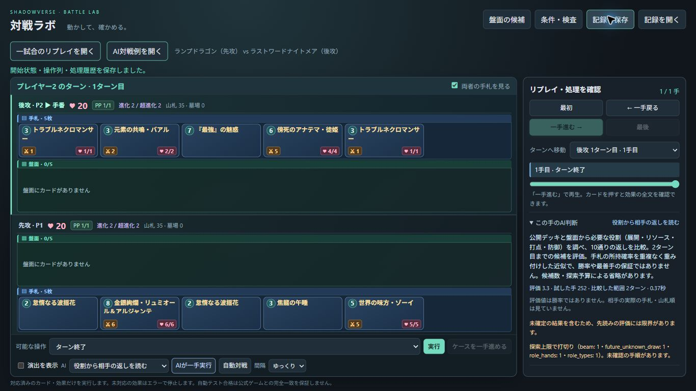

# 役割AIの検証記録

対象: 公開デッキと役割から相手の返しを生成する `roles` 方式。利用方法・確率の意味・制約は [battle-roles.md](../../battle-roles.md)。

## 検証対象と結果

正常系は複数の役割、条件・進化・生成札の順序、役割ごとの候補保持、公開API・保存再生・評価コマンドを対象とした。境界は手札の重複、枚数不足、ランダム枝の予算切れ、未知ドロー、手札溢れ、使える札がない返し、比較範囲の一致を対象とした。エラー系は候補数・確率入力の型と範囲を対象とした。

- 厳密な型検査: 変更したAI・API・CLIとテストの11ファイル、PASS。
- JavaScript: `node --check src/svdeck/battle_web/app.js`、PASS。
- 関連テスト: `pytest -q tests -k 'battle or combat' --tb=short`、**1418 passed / 4 skipped / 211 deselected、72.59秒**。
- 新方式の接続テスト: 41件PASS。追加した探索境界の回帰6件は上記全体テストに含む。
- 静的レビューで見つかった、未知ドローの確定扱い・確率枝の混在・後続候補の予算不足・手札不要候補の脱落・公開消費の反映漏れを修正。小再現で再確認した。

全探索・最善手・強さの証明ではない。スキップ4件をPASS件数には含めていない。

## 開発中の試走

seed93002、rolesランプドラゴン（先手）対searchラストワードナイトメア。K=5、1500遷移、3秒予算、要求3ターン。これは既定予算の比較実験とは別の動作確認。

| 測定 | 結果 |
|---|---:|
| 結果 | roles側勝利、57操作で終局 |
| 対戦時間 | 42.064秒 |
| roles判断数 | 29 |
| roles判断時間平均 / 最大 | 1.387秒 / 2.135秒 |
| 全判断時間平均 | 0.736秒 |
| プロセスのピークメモリ | 54.23 MiB |
| rolesの比較境界 | 2ターン28回、終局評価3ターン1回 |

保存・再生の最終状態は一致。メモリはWindows `PeakWorkingSetSize`、プロセス寿命全体。単体テストとの短時間の並行実行を含むため、厳密な単独性能比較には用いない。

再現コマンド:

```powershell
.venv/Scripts/python.exe -X utf8 -m svdeck.battle_training replay --output output/role-response-dev-game.json --policy roles --opponent search --seed 93002 --decks ramp-dragon last-words-nightmare --role-k 5 --max-nodes 1500 --seconds 3 --turns 3
```

## 独立した利用者検証

実装前に [spec.v1.json](spec.v1.json) と [independent-fixtures.v1.json](independent-fixtures.v1.json) を固定した。実装・設計担当とは別の新しい担当が、公開入口からT1（局面・確率・非公開情報）、T2（先後2試合）、T3（画面・保存再生）を検証する。

T3の開始前にブラウザの保存領域を隔離できないことが分かったため、通常データに触れないURLセッションを用意し、別の設計担当が [spec.v2.json](spec.v2.json) に開始方法だけを改訂した。[同値対応表](revision-rationale.v2.json) のとおり、操作・機能・UX・予算の条件とT1/T2は維持した。未実行だったT3を成功扱いしてはいない。

T2は [独立レポート](acceptance-t2.json) でPASS。seed93001、既定K=5・6000遷移・8秒予算・要求3ターン。rolesがドラゴンを担当し、先後を交換した2試合を実行した。

| 条件 | 先手roles / 後手search | 先手search / 後手roles |
|---|---:|---:|
| 結果 | roles敗北 | roles敗北 |
| 操作数 | 61 | 59 |
| プロセス全体時間 | 157.007秒 | 146.314秒 |
| roles判断時間平均 | 6.036秒 | 6.156秒 |
| workerピークメモリ | 79.60 MiB | 75.72 MiB |
| 実際の比較範囲 | 2ターン24回 / 1ターン1回 | 2ターン22回 / 1ターン1回 |

全120操作が合法で、各保存状態・判断・通常リプレイの最終状態が一致。2試合は並行実行したため、単独性能の比較ではない。**動作は確認できたが、強さの改善は確認できていない。** 軽い設定の別seedでの1勝と合わせても優劣の根拠にはしない。

通常の保存記録は `output/roles-acceptance-t2/game1-replays/` と `output/roles-acceptance-t2/game2-replay.json`、局面ごとの判断・測定・照合は同じ専用ディレクトリに保存した。

T1は、最初の担当の計時に入力準備が含まれていたため、その結果を完全合格とはせず保存した。別の新しい担当が同じ固定仕様を実行し、入力準備とPlayer生成を計時の外に置いた。**152検査・42候補の合法再生がPASS**、75回の公開呼出しを記録。K=3/5/10での即時勝利、致死打点を防ぐ交換、回復・守護・全体除去の保持、生成札、条件付き能力、確率の重複排除、非公開情報の置換に対する不変性を含む。プロセスピークは53.99 MiB。公開呼出しバッチは4.128秒、検算等を含むjourneyは162.648秒。

T3は画面での方式選択、一手実行、判断表示、ファイル保存、画面内の最初→一手進む操作まで確認。1366×768でページスクロールなし、主要操作と盤面・判断が読めることは別の目視担当もPASSとした。

**T3全体はINCOMPLETE**。保存したファイルを「記録を開く」で読み込む操作は、自動承認チェックが「ユーザーの明示的なアップロード許可がない」として拒否した。回避せず停止し、許可を依頼した。対象は、このテストで作った `C:/Users/tasog/Downloads/battle-1790745126097.json`。ファイルの開き直しを確認済みとはしていない。通常のAPI/CLIでの保存再生は別途PASS。

[統合記録](acceptance.v2.json) はT1 PASS、T2 PASS、T3 INCOMPLETEをそのまま保持する。仕様ロックはPASS。統合レポートの形式検査は `report.scheduling.batch_count: must use the minimum number of batches` でFAILだった。理由は、完了済みT2を同値対応で再利用し、計時修復後T1と開始方法修復後T3を別の時期に実行したため。この世代をまたぐ2バッチを、全3試験同時の1バッチへ改ざんしていない。形式検査の失敗を製品テストの失敗とも合格とも読み替えない。


